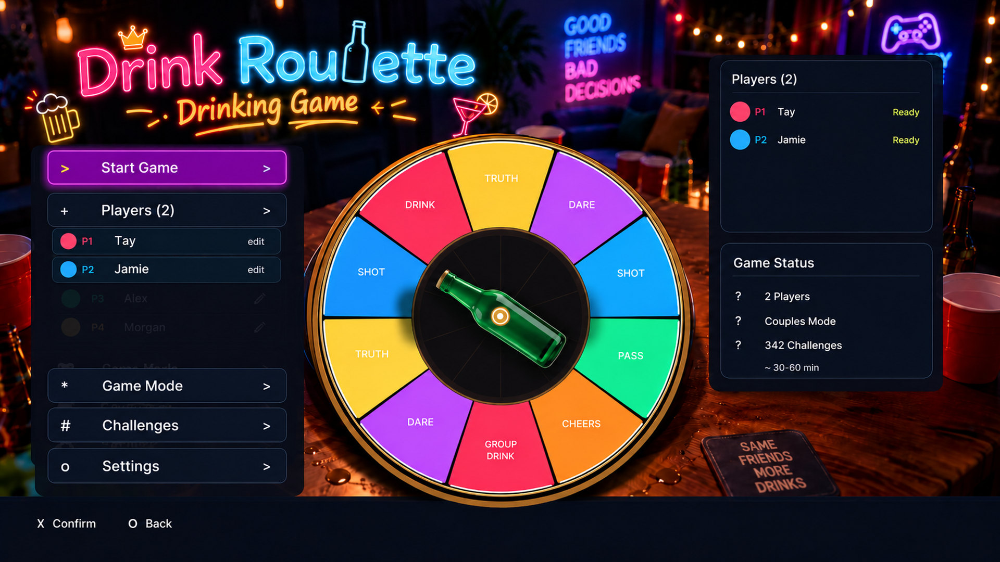

# Drink Roulette — PS5 Homebrew

**Drink Roulette by YAHBALLON** is an offline, native PS5 party game with an animated bottle roulette wheel, controller-friendly neon interface and **433 unique challenges**.

| Property | Value |
| --- | --- |
| Latest version | **v0.1.6** |
| PS5 Title ID | `PPSA99841` |
| Creator | **YAHBALLON** |
| Language | English |
| Players | 2–8, one controller (pass and play) |
| Game modes | Standard, Wild, Couples, Quickfire, Truth & Dare |
| Challenge packs | Light, Normal, All Challenges |
| Runtime | Native C++ / OpenGL via [PS5-DevBridge](https://github.com/Yahballon/PS5-DevBridge) |

## Download

Go to [GitHub Releases](https://github.com/Yahballon/Drink_Roulette/releases) and download **PPSA99841.zip**. Install the title folder using your compatible jailbroken-PS5 homebrew loader. This is a native PS5 title, **not** a PC executable or a retail PS5 game.

## First-time setup

1. Choose **2–8 players** and enter names with the controller-driven on-screen keyboard.
2. Select a game mode and challenge pack.
3. Confirm the summary and enter the lobby.
4. Select **Start Game**, press **X** to spin, and follow the randomly chosen prompt.
5. Continue to the next player with **X**; **O** returns to the menu.

D-Pad navigates menus, **Triangle** opens Rules on the home screen, **Square** edits a selected name, and **Options** can save an edited name.

The **NOW PLAYING** panel is located at the **top-left**, underneath the neon logo. The spinning glass bottle and colored wheel stay in the middle of the screen.

## Build from source

The workflow `.github/workflows/build.yml` checks out this repository, runs native C++ game-logic tests, fetches the pinned PS5 framework/graphics dependencies, creates the `PPSA99841` signed title, and validates its installation ZIP.

The included `assets/bottle.png` is converted at build time into `assets/bottle.rgba` (512×512 RGBA8) so the PS5 app does not depend on its PNG decoder at runtime.

Main files:

- `native/main.cpp` — display, game UI, glass bottle rendering and DualSense input
- `native/game.hpp` — state machine, players, game modes and roulette selection
- `native/challenges.hpp` — 433 offline prompts
- `assets/` — UI backdrop, bottle source art and generators
- `tests/game_test.cpp` — game logic regression test
- `app.json` — app metadata and PS5 title identity

## Save data & logs

Settings and player names persist in `/data/DrinkRoulette/settings.ini`. For troubleshooting check `/data/DrinkRoulette/drink-roulette.log`.

All activities are optional; non-alcoholic alternatives are welcome. The app contains no copyrighted game ROMs or Sony/PlayStation trademarks.

## License

Source code: GPL-3.0-or-later. The native UI framework retains its own license. Artwork was supplied/approved for this project; check rights before redistributing assets separately.
